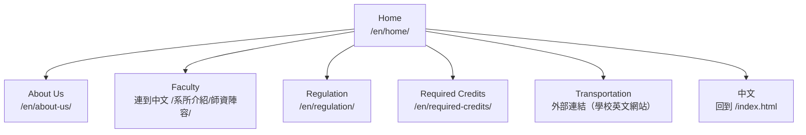

# 網站架構圖

依本存放庫的實際頁面整理：主選單取自首頁 `index.html` 的 `menu-main-menu`，英文版選單取自 `en/home/index.html`，其餘為選單以外但存在的頁面。頁面有增減時請同步更新本檔。

圖中每個方塊的第二行是該頁在存放庫中的資料夾。

## 中文主選單

```mermaid
flowchart TD
    home["首頁<br/>/index.html"]

    home --> about["系所介紹"]
    home --> course["課程資訊"]
    home --> achieve["常態消息<br/>/學習成果/"]
    home --> news["消息公告<br/>/常態消息/"]
    home --> en["English<br/>/en/home/"]

    about --> a1["系所沿革<br/>/系所介紹/系所沿革/"]
    about --> a2["師資陣容<br/>/系所介紹/師資陣容/"]
    about --> a3["課程簡介<br/>/系所介紹/課程簡介/"]
    about --> a4["教學設備<br/>/系所介紹/教學設備/"]
    about --> a5["傑出校友<br/>/系所介紹/傑出校友/"]
    about --> a6["聯絡我們<br/>/系所介紹/聯絡我們/"]
    a2 --> teacher["教師個人頁（22 位）<br/>/teacher/姓名/"]

    course --> c1["學生手冊<br/>/課程資訊/學生手冊/"]
    course --> c2["科目學分表<br/>/課程資訊/科目學分表/"]
    course --> c3["法令規章<br/>/課程資訊/法令規章/"]
    course --> c4["表格下載<br/>/課程資訊/表格下載/"]

    achieve --> r1["榮譽榜<br/>/學習成果/榮譽榜/"]
    achieve --> r2["國際交流<br/>/學習成果/國際交流/"]
    achieve --> r3["出版刊物<br/>/學習成果/出版刊物/"]
    achieve --> r4["研討會<br/>/學習成果/研討會/"]

    news --> n1["系所公告<br/>/常態消息/系所公告/"]
    news --> n2["活動訊息<br/>/常態消息/活動訊息/"]
    news --> n3["招生訊息<br/>/常態消息/招生訊息/"]
    news --> n4["展覽資訊<br/>/常態消息/展覽記錄/"]

    r1 & r2 & r3 & r4 & n1 & n2 & n3 & n4 --> post["文章頁（約 424 篇）<br/>/年/月/標題/"]
```

## 英文版

## 選單以外的頁面

| 類型 | 位置 | 說明 |
| --- | --- | --- |
| 文章頁 | `/年/月/標題/` | 1900–2026 年的文章，約 424 篇，由各列表頁連入 |
| 分類彙整 | `/cat/分類名/` | 傑出校友、出版刊物、國際交流、學習成果、展覽資訊、最新消息、未分類、活動訊息、系所公告 |
| 標籤彙整 | `/tag/標籤名/` | 畢業專刊、雕塑年度展、國際袖珍雕塑展等 18 個標籤 |
| 列表分頁 | `…/page/2/` 等 | 「學習成果」「常態消息」與「傑出校友」列表的第 2 頁以後 |
| 其他 | `/學習成果/展覽記錄/`、`/最新消息/活動訊息/` | 舊版分類網址，目前不在主選單中 |
| 單頁 | `/115雕塑研究生手冊1150812-2/` | 研究生手冊 |
| 靜態資源 | `/wp-content/`、`/wp-includes/` | 圖片、PDF、樣式與程式 |

## 注意

選單名稱和資料夾名稱有兩處對不上，修改時容易搞混：

- 選單「常態消息」連到的是 `/學習成果/`。
- 選單「消息公告」連到的是 `/常態消息/`；其下「展覽資訊」連到 `/常態消息/展覽記錄/`。
